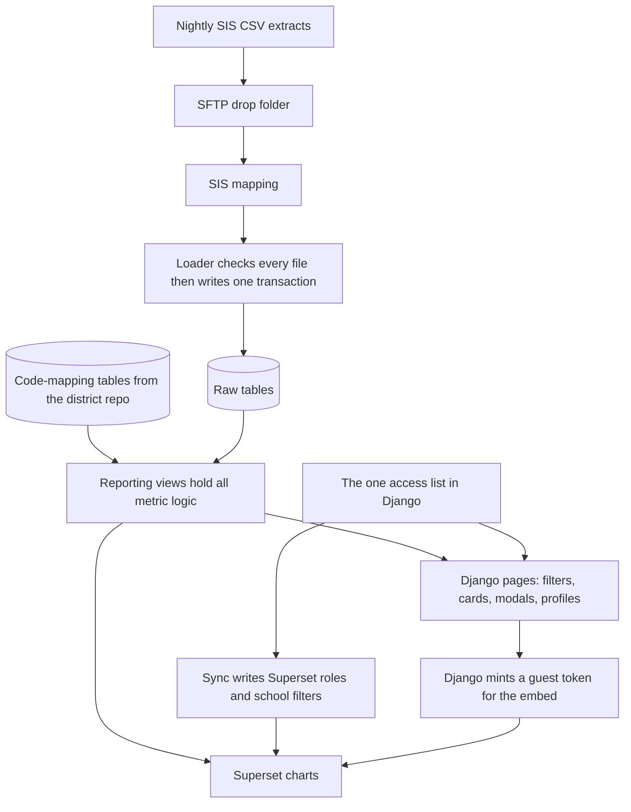
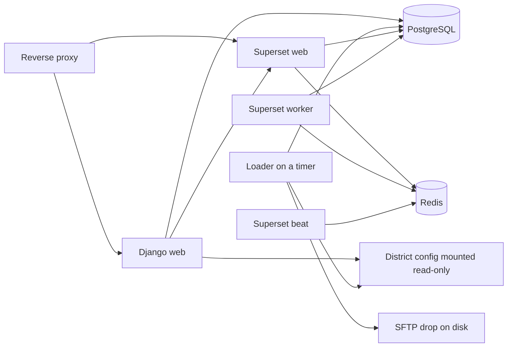

# Architecture

Living map of CampusView. The approved screen is Django pages with embedded Superset charts: clickable cards open a modal table, and the charts sit in the same page and follow the same filters. This document sketches modules, types, and interfaces before any application code exists. [PLAN.md](PLAN.md) wins if something here conflicts with it.

A **view** is a saved query in PostgreSQL. Pages and charts read views. They do not re-decide what "absent" or "open" means.

## Path from file to page

1. The district drops a full CSV snapshot on SFTP. CampusView never connects to the student information system.
2. The mapping for that system rewrites the vendor files into CampusView's standard layouts. v1 ships the Infinite Campus mapping only. See [DATA_CONTRACT.md](DATA_CONTRACT.md).
3. The loader checks every standard file and every code-mapping file. If any check fails, it loads nothing and leaves the previous data in place. If every check passes, it replaces the raw snapshot in one database transaction.
4. Raw tables store explicit columns only. Code-mapping tables, from the district repo, say what each local code means.
5. Reporting views join raw rows to those maps and expose every number the dashboards show. The metric list is [METRICS.md](METRICS.md).
6. Django draws the page. Superset draws the tagged charts. Both read the same views, through the school limits in [ACCESS.md](ACCESS.md).

No view restricts itself to a school, a year, a grade, or a gender. The caller applies those filters. Views may omit rows that never count, such as a cancelled referral or a day that is not a school day.

Ordinary views, not materialized views, are the default. "Today" and "expiring in 30 days" have to move forward each morning. A view is materialized only after a real query is proven slow, and a materialized view that depends on today's date is refreshed on a schedule that keeps it honest.

## Types

These names are the vocabulary for later code and SQL. They are a sketch, not a program.

| Name | Meaning |
| --- | --- |
| `SchoolId` | Text id from the extract. Stable. Not invented by CampusView. |
| `StudentId` | Text student number from the extract. Never an SSN or a state id. |
| `SchoolYear` | Text `YYYY-YYYY`, second year = first + 1. Example shape: `2026-2027`. |
| `Grade` | Text `K` or `1` through `12`, after the grade map. |
| `GenderLabel` | Text label from the gender map. |
| `Portion` | Decimal from 0 through 1. `1` is a full day, `0.5` is a half day. |
| `RoleName` | Text stored as data. The three starter roles can be renamed. |

Filter bar, on every dashboard page:

| Filter | Value |
| --- | --- |
| School year | One `SchoolYear`. Starts on the latest year in the loaded calendar. |
| School | All granted schools, or one `SchoolId`. |
| Grade | All, or one `Grade`. |
| Gender | All, or one `GenderLabel`. |

Changing a filter refreshes the cards, the embedded charts, and an open modal together.

## Module map

Later code is expected to split along these lines. Step 0 creates none of it.

| Module | Responsibility | Reads | Writes |
| --- | --- | --- | --- |
| `ingest.drop` | Watch the SFTP folder | Files on disk | Nothing |
| `ingest.map.infinite_campus` | Vendor files to standard files | Vendor CSV | Standard CSV in a temp folder |
| `ingest.loader` | Validate, then load all or nothing | Standard CSV, district maps | `raw`, `ref`, `ops.load_batch` |
| `warehouse.raw` | Snapshot tables | | |
| `warehouse.ref` | Code-mapping tables | | |
| `warehouse.reporting` | Views only | `raw`, `ref` | |
| `accounts` | Google sign-in, users, roles, school grants | | App tables |
| `access` | Shared query path, guest tokens, Superset sync, audit | Grants, reporting views | Audit log, Superset API |
| `pages` | Filter bar, cards, modals, profiles, preferences | Reporting, via `access` | Preferences |
| `admin_screens` | Users, grants, card config, load history, audit read | App tables | App tables |

Page routes the later steps will add:

| Route | Who | Purpose |
| --- | --- | --- |
| Sign-in and the Google callback | Signed out | The only pages that do not require a session |
| Overview, Behavior, Attendance | Signed in | Dashboards |
| Student profile | Signed in | One student, if a granted school enrolls them |
| Modal rows and CSV export | Signed in | Same view and filters as the card |
| Preferences | Signed in | Default school, theme, saved filters, own card order |
| Users, grants, cards, loads | System admin | Settings |
| Audit log | System admin | Read the append-only log |
| Guest-token endpoint | Signed in | Returns a short-lived embed token, or refuses |

## Loader interface

`load(drop_dir, district_config_dir) -> LoadResult`

- Look in `drop_dir` for the standard extract files and in `district_config_dir` for the code-mapping files. Both sets are required.
- Validate every file first: headers, types, keys, allowed codes, and foreign keys. Details are in [DATA_CONTRACT.md](DATA_CONTRACT.md).
- On any error, leave the previous snapshot in place. Record the failed attempt on `ops.load_batch` with the file name, the row number, and the rule that failed. Do not record the cell value.
- On success, replace the raw snapshot inside one transaction, purge school years outside the history window, and commit.
- The drop is a full snapshot of the years to keep, not a file of changes. Running the same files twice leaves the same warehouse.
- History length is a district setting, default 2: the newest school year in the drop and the one before it.
- After a successful commit, run the Superset sync so a new school exists in the access filters.

The load runs as a timed Django management command in the loader container. It takes a lock so two runs cannot overlap. It does not use Celery. Celery and Redis exist only for Superset.

Logs and `ops.load_batch` may include file names, row counts, row numbers, and rule names. They may not include cell values, student names, or ids from the row that failed.

## Raw schema and mapping tables

PostgreSQL schemas:

| Schema | Holds | Who may read it |
| --- | --- | --- |
| `raw` | One table per standard file, plus load metadata columns (`load_id`, `loaded_at`) | Loader. Not Django pages. Not Superset. |
| `ref` | Code-mapping tables | Loader, and the reporting views |
| `reporting` | Views | Django web role, Superset role, both `SELECT` only |
| `ops` | `load_batch` | Loader writes; system admin reads in the app |
| `app` | Users, roles, grants, preferences, card config | Django |
| `audit` | Append-only events | Django may insert and select. Update and delete are revoked |
| `scratch` | Empty on a normal install | Testing install only, and only the sandbox database user |

Table names match the files in [DATA_CONTRACT.md](DATA_CONTRACT.md): `raw.schools`, `raw.students`, `raw.enrollments`, `raw.calendar_days`, `raw.attendance`, `raw.incidents`, `raw.incident_behaviors`, `raw.consequences`, `raw.plans`.

Relationships, all by the text ids in the files:

- An enrollment belongs to one student and one school.
- A calendar day belongs to one school.
- An attendance row belongs to one student, one school, and one calendar day.
- An incident belongs to one student and one school. Behavior rows and consequences belong to one incident.
- A plan belongs to one student. The school it reports under is chosen in the reporting view, from the student's primary enrollment.

Only a primary enrollment creates membership days. A second, non-primary enrollment must not double-count a day.

## Reporting views

Each dashboard number reads one of these views. Django and Superset may sum, count, average, or divide columns the view already computed. They may not re-code attendance or behavior. The allow-list of view names is part of the app, and card config cannot point at anything else.

| View | One row is | Used by |
| --- | --- | --- |
| `reporting.v_attendance_student_day` | One enrolled student on one school day | Year-to-date rate, monthly trend, unexcused absences, tardies, and the attendance modal |
| `reporting.v_attendance_month` | One school, year, month, grade, and gender, with the day totals already summed (including unexcused absence days) | Monthly trend, and unexcused absences by month |
| `reporting.v_chronic_student_school` | One student at one school in one year | Chronic absenteeism by grade |
| `reporting.v_last_school_day_absence` | One student absent on their school's last school day | Absence card and its modal |
| `reporting.v_incident` | One referral | Referral counts, days to action, top 10 students |
| `reporting.v_behavior_event` | One coded behavior on a referral | Behavior bars, month, grade, location, heatmap |
| `reporting.v_referrals_by_student` | One student at one school in one year | Top 10 students, repeat referrals |
| `reporting.v_open_referral` | One open referral | Open referrals list |
| `reporting.v_consequence` | One consequence | Consequences chart |
| `reporting.v_plan` | One plan | Active 504 and IEP cards and their modals |
| `reporting.v_equity_referral_rate` | Totals for one group | Equity chart. No student id and no name column |

`v_equity_referral_rate` is the only view that uses race or ethnicity, and only as a group label on a total. Named views do not have a race column, so a chart builder cannot drop one onto a working list.

Every view above includes `school_id` and `school_year`. Views that can be filtered by grade or gender include those columns too. Superset datasets are these views. The sync refuses a dataset that has no `school_id`.

Column-level formulas are in [METRICS.md](METRICS.md). Items still waiting on Austin are listed there and are not settled by this map.

## How a page asks for rows

`scoped_rows(user, view_name, filters) -> rows`

1. The user has a session. Anonymous callers never reach this function.
2. Resolve the user's school scope from the access list: a set of `SchoolId`, all schools, or none.
3. No role, or a scope of none, returns no rows.
4. If the filter names one school, that school must sit inside the scope. Otherwise return no rows.
5. `view_name` must be on the allow-list.
6. Query that view with the scope and the filter bar. Return the rows.

Cards, modals, CSV export, student profiles, and the guest-token builder all call this function. A preference, a saved filter, or a school id typed in the address bar cannot widen the scope. If a saved default school is no longer granted, it is ignored.

Export calls `scoped_rows` again with the filters shown on the modal, then writes an audit row. The file contains those columns and those rows, not the unfiltered warehouse. Print prints the modal that is already open.

The student profile calls `scoped_rows` for each of that student's attendance, behavior, and plan views, plus a check that the student has a primary enrollment in a granted school for the selected year. A guessed id outside that scope returns nothing, and the attempt is still audited.

## Access list, sync, and guest tokens

Django stores users, roles, and school grants. That list is the source of truth. Superset is a copy. A row-level filter is the rule Superset applies so a chart only returns rows for schools on that person's list. [ACCESS.md](ACCESS.md) has the roles and the test matrix. The mechanics:

**Sync** runs when a grant is saved, after every successful load, and on a slow safety timer.

- Each CampusView user has a matching Superset user, found by email.
- A user who may see all schools gets a viewer role with no school predicate.
- Any other user gets a personal Superset role whose row-level filter is `school_id` in their granted ids.
- A user with no schools gets a filter that matches nothing (`1 = 0`). An empty `IN ()` list is not valid SQL and must not be sent.
- The viewer role can query the published reporting datasets. SQL Lab, chart editing, and Superset's own CSV download stay off for that role.
- The system admin also receives the builder role: SQL Lab and chart editing. See [METRICS.md](METRICS.md) for the open question on the system admin's Superset download.
- Sync replaces the school filter from Django's list. It does not merge with hand edits. If the Superset call fails during a grant save, the grant save fails too, so Django and Superset do not diverge.
- Direct Superset login uses the stored filter. Embedded charts use a guest token minted at page load, so they pick up a grant change immediately.

**Guest token**, `guest_token(user, chart_id, filters) -> token or refuse`:

1. Call the same scope rules as `scoped_rows`.
2. If the scope is empty, do not ask Superset for a token. The page shows an empty state.
3. Ask Superset's guest-token API, server to server, for a short-lived token. The row-level clause lists only schools inside the scope, narrowed further when the filter bar has one school selected.
4. Pass the year, grade, and gender as chart filters. Those are filters, not the security boundary. The school clause is the boundary.
5. The browser uses the token with Superset's embedded SDK. The browser cannot widen it. The service credential that mints tokens stays on the Django server.

Grade and gender are never treated as permissions. School is the only row-level restriction in v1. Caseload-based access is parked.

## Containers

| Container | Image role | Published to the network |
| --- | --- | --- |
| Reverse proxy | TLS, security headers, routes `/` to Django and the embed path to Superset | Yes, this is the only public port |
| Django web | Pages, guest tokens, sync | Internal only |
| Loader | Same Django image, one timed management command | Internal only |
| PostgreSQL | Warehouse | Internal only, no host port |
| Redis | Superset cache and Superset's Celery queue | Internal only |
| Superset web | Charts and the guest-token API | Through the proxy, for the embed script |
| Superset worker and beat | Jobs Superset schedules for itself | Internal only |

The loader is not a Celery worker. Redis is not used for CampusView loads.

Every container runs as a non-root user, with no extra privileges. Secrets (database passwords, Django secret, Google client secret, Superset secret, guest-token credential) come from the server environment or Docker secrets. They are not baked into images, and they are not in either git repo.

The district repo is mounted into the web and loader containers as config: code mappings, branding, exported dashboards, display name, time zone, and history length. Upgrades replace the application image and run migrations. They do not replace that mount. Student extracts live in the SFTP drop on the server disk, which is outside both git repos.

Django reaches Superset at an internal address to mint tokens. The browser reaches Superset only through the proxy, with a guest token, to draw a chart. There is no public self-signup on Superset.

## Installer and releases

The installer script installs Docker when it is missing, asks for the server settings, writes secrets to the server env file, starts the containers, and runs migrations. Non-secret district settings live in the district repo, not in the product repo.

The product repo builds a release only as a tag such as `v1.3.0`. The live server pulls a tag. CI for a release installs that tag on a clean machine and upgrades a machine that was on the previous tag. The testing install runs the same tag and may load fake data. Production refuses the fake-data command.

The testing database has one extra user for the AI sandbox: it can read `raw` and `reporting`, and it can create objects only in `scratch`. Production does not have this user. A view that is ready to keep is added as a migration in the product repo, with a hand-checked test, and arrives through a release.

## Pages, in product terms

Three pages share one filter bar: Overview, Behavior, and Attendance. Styling, the filter bar, the cards, the modal, print, and preferences are Django. Panels that chart a breakdown (top students, behavior bars, open referrals, trends, heatmap, equity, chronic by grade) are embedded Superset charts reading the views above.

Card config in admin screens chooses which of the six overview cards exist, their district order, and on or off. A user can reorder the enabled cards for themselves and can set a default school, a light or dark theme, and saved filters. The theme is Django's. Charts use Superset's built-in theme with minimal custom CSS, so a chart may not follow the page theme. Drag-and-drop layout, sparklines, and "versus last year" text on the cards themselves are parked and are not part of this page.

Exported Superset dashboards are files in the district repo. Agents do not edit them. A chart change is done in Superset by the system admin and exported again.
