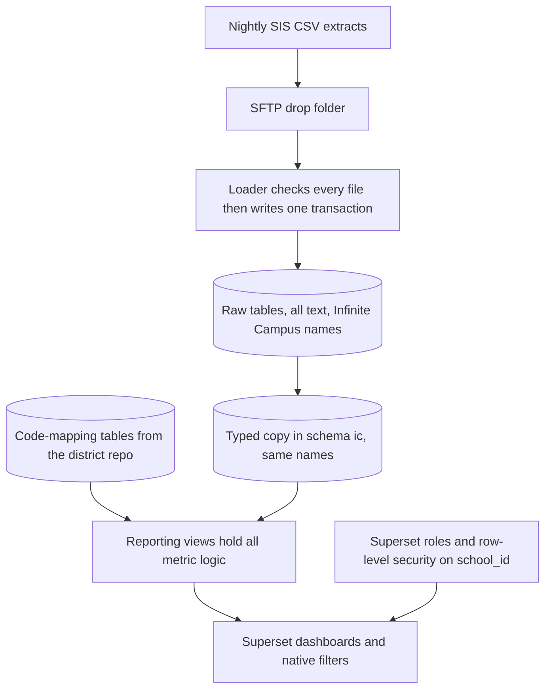
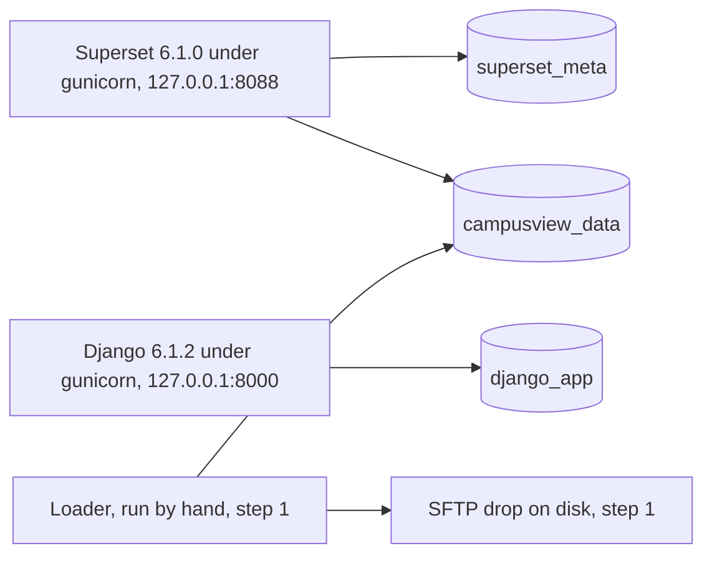

# Architecture

Living map of CampusView. In v1 the screen staff use is plain Apache Superset: its dashboards, charts, native filters, theme settings, roles, and row-level security. There are no custom Django pages. [PLAN.md](PLAN.md) wins if something here conflicts with it.

A **view** is a saved query in PostgreSQL. Charts read views. They do not re-decide what "absent" or "open" means.

## Path from file to dashboard

1. The district drops a full CSV snapshot on SFTP. CampusView never connects to the student information system.
2. The loader checks every Infinite Campus file. Nothing is renamed. If the load fails (a header or column problem, a missing or unexpected file, a row PostgreSQL rejects, an empty `school.csv` or `calendar.csv`, or a bad district code-mapping file), it loads nothing and leaves the previous data in place. If every check passes, it replaces the raw snapshot in one database transaction. See [DATA_CONTRACT.md](DATA_CONTRACT.md).
3. Raw tables store every column the contract lists, as text, with the Infinite Campus names. Nothing is dropped, and an unknown header fails the file.
4. A typed, checked copy of each raw table keeps the same table and column names, with real dates and numbers. It lives in schema `ic`, so `raw.enrollment` becomes `ic.enrollment`. Bad values (stored as NULL), bad keys, unknown codes, and cross-row problems are warnings on the load report, and loading continues. A row that fails a cross-row check is kept as it is and still counts. Code-mapping tables, from the district repo, say what each local code means. See 2026-11-03 "The typed layer keeps the Infinite Campus names" in [DECISIONS.md](DECISIONS.md).
5. Reporting views join the typed copy to those maps and expose every number the dashboards show. The SQL is in this repo. The metric list is [METRICS.md](METRICS.md).
6. Superset dashboards read the views. Superset's roles and row-level security limit each person to their schools. See [ACCESS.md](ACCESS.md).

**Built so far (step 1, on `dev`):** a loader that reads one folder of Infinite Campus CSV files and loads each file, as it arrives, into its own all-text table in `raw`. It checks file names and headers. It does not yet check types, keys, codes, or foreign keys, and it reads no code-mapping files. SFTP and the typed copy (step 4) are not built yet. The typed copy is the next step 1 pull request after the update command.

No view restricts itself to a school, a year, a grade, or a gender. Superset applies those: school through row-level security, and year, grade, and gender through native filters. Views may omit rows that never count, such as a cancelled referral or a day that is not a school day.

Ordinary views, not materialized views, are the default. "Today" and "expiring in 30 days" have to move forward each morning. A view is materialized only after a real query is proven slow, and a materialized view that depends on today's date is refreshed on a schedule that keeps it honest.

## Types

These names are the vocabulary for later code and SQL. They are a sketch, not a program.

| Name | Meaning |
| --- | --- |
| `SchoolId` | Text id from the extract. Stable. Not invented by CampusView. |
| `StudentId` | Text student number from the extract, the one staff see. Not the SSN or the state id; a state id the extract sends is kept as its own listed column. |
| `SchoolYear` | Text `YYYY-YYYY`, second year = first + 1. Example shape: `2026-2027`. |
| `Grade` | Text `K` or `1` through `12`, after the grade map. |
| `GenderLabel` | Text label from the gender map. |
| `Portion` | Decimal from 0 through 1. `1` is a full day, `0.5` is a half day. |
| `RoleName` | A Superset role name. The three starter roles can be renamed. |

Native filters, on every dashboard:

| Filter | Value |
| --- | --- |
| School year | One `SchoolYear`. Starts on the latest year in the loaded calendar. |
| School | All schools the person may see, or one `SchoolId`. |
| Grade | All, or one `Grade`. |
| Gender | All, or one `GenderLabel`. |

Filters only narrow what row-level security already allows. A filter is never a permission.

## Module map

Later code is expected to split along these lines. Only the `loader` package exists today. It reads the Infinite Campus CSV files and writes `raw` and `ops.load_batch`.

| Module | Responsibility | Reads | Writes |
| --- | --- | --- | --- |
| `ingest.drop` | Watch the SFTP folder | Files on disk | Nothing |
| `loader` (built) | Validate, then load all or nothing | Infinite Campus CSV | `raw`, `ops.load_batch` |
| Typed copy (module name to be decided) | Typed, checked copy of each raw table, same names; bad values (stored as NULL), bad keys, unknown codes, and cross-row problems are warnings on the load report | `raw`, district maps | `ic` |
| `warehouse.ic` | Typed copy tables. Not built | | |
| `warehouse.raw` | Snapshot tables, all text | | |
| `warehouse.ref` | Code-mapping tables | | |
| `warehouse.reporting` | Views only, as SQL files in this repo | The typed copy, `ref` | |

Dashboards, charts, filters, roles, and row-level security are Superset settings, not code in this repo. Dashboards are exported to the district repo.

## Loader interface

**Built today:** `python -m loader FOLDER`, which calls `load_drop(folder)` in `loader/load.py` and returns whether the load passed, whether the report was saved, and the report text. Exit code 0 means it passed and the report was saved, 1 means anything else, and 2 means the command was used wrong. It checks the 24 file names and the headers in `loader/contract.py`, loads all or nothing in one transaction, and stores the report text in `ops.load_batch`. It takes a lock, and a second load fails at once instead of waiting. It reads no district folder, does no history purge, and runs by hand, not on a timer. The guide is [guides/sftp-and-extracts.md](guides/sftp-and-extracts.md).

Planned: `load(drop_dir, district_config_dir) -> LoadResult`

- Look in `drop_dir` for the Infinite Campus extract files and in `district_config_dir` for the code-mapping files. Both sets are required.
- Validate every file first: headers (an unknown or misspelled header fails the file). The typed copy then checks values, keys, codes, and cross-row rules. Those are warnings on the load report, a bad value is stored as NULL in `ic`, a row that fails a cross-row check is kept as it is, and loading continues. Details are in [DATA_CONTRACT.md](DATA_CONTRACT.md).
- On any failure (a header or column problem, a missing or unexpected file, a row PostgreSQL rejects, an empty `school.csv` or `calendar.csv`, or a bad district code-mapping file), leave the previous snapshot in place. Warnings do not stop the load. Record the failed attempt on `ops.load_batch` with the file name, the row number, and the rule that failed. Do not record the cell value.
- On success, replace the raw snapshot inside one transaction, purge school years outside the history window, and commit.
- The drop is a full snapshot of the years to keep, not a file of changes. Running the same files twice leaves the same warehouse.
- History length is a district setting, default 2: the newest school year in the drop and the one before it.
- After a successful commit, a school that is new to the drop has no school admin yet. Until someone adds it to a Superset role's row-level security, only the all-schools roles see it. See the open question on school assignments in [ACCESS.md](ACCESS.md).

The load will run as a timed job on the server; the timer is a later step. It takes a lock so two runs cannot overlap (built). It does not use Celery; there is no Celery or Redis in v1.

Logs and `ops.load_batch` may include file names, row counts, row numbers, and rule names. They may not include cell values, student names, or ids from the row that failed.

## Raw schema and mapping tables

These schemas live in the `campusview_data` database. Superset's own settings are in `superset_meta`, and Django's default tables are in `django_app`. Neither of those holds student data.

**Resolved 2026-11-02:** the installer creates two accounts for `campusview_data`. `campusview_owner` owns the database and the schemas `raw`, `ref`, and `reporting`; the loader writes as it in step 1. `campusview_reader` can connect and `SELECT` from `reporting` only, including anything added there later. Superset's data connection should use `campusview_reader`; the installer does not create that connection. `superset_user` owns only `superset_meta` and cannot connect to `campusview_data`. Upgrades rename an old `mapping` schema to `ref`. See [ACCESS.md](ACCESS.md) and [DECISIONS.md](DECISIONS.md).

Schemas in `campusview_data`:

| Schema | Holds | Who may read it |
| --- | --- | --- |
| `raw` | One table per Infinite Campus file, every column text, no load metadata columns | Loader (`campusview_owner`). Not Superset. |
| `ic` | The typed copy: one table per raw table, same names, real dates and numbers, for example `ic.enrollment`. Not created yet; it comes with the typed-copy pull request | Loader (`campusview_owner`), and the reporting views. Not Superset. Same owner and grants as `raw` |
| `ref` | Code-mapping tables | Loader (`campusview_owner`), and the reporting views |
| `reporting` | Views | `campusview_reader` (Superset's data connection), `SELECT` only |
| `ops` | `load_batch`: `batch_id`, `started_at`, `finished_at`, `outcome`, `fault`, `report`. The loader creates the schema and the table on its first run | `campusview_owner` only. No grant is made to `campusview_reader` |
| `scratch` | Empty on a normal install | Testing install only, and only the sandbox database user |

The table names are the Infinite Campus file names without `.csv`, for example `raw.enrollment` and `raw.day`. The full list is in `loader/contract.py`. The typed copy in `ic` uses the same table and column names. The vendor-neutral names in the standard-layout sections of [DATA_CONTRACT.md](DATA_CONTRACT.md) (`schools`, `students`, `calendar_days`, and so on) are not table names.

Relationships, all by the text ids in the files:

- An enrollment belongs to one student and one school.
- A calendar day belongs to one school.
- An attendance row belongs to one student, one school, and one calendar day.
- An incident belongs to one student and one school. Behavior rows and consequences belong to one incident.
- A plan belongs to one student. The school it reports under is chosen in the reporting view, from the student's primary enrollment.

Only a primary enrollment creates membership days. A second, non-primary enrollment must not double-count a day.

## Reporting views

Each dashboard number reads one of these views. The SQL for every view is kept in this repo. A Superset chart may sum, count, average, or divide columns the view already computed. It may not re-code attendance or behavior. Superset datasets point only at these views, never at raw tables.

| View | One row is | Used by |
| --- | --- | --- |
| `reporting.v_attendance_student_day` | One enrolled student on one school day | Year-to-date rate, monthly trend, unexcused absences, tardies |
| `reporting.v_attendance_month` | One school, year, month, grade, and gender, with the day totals already summed (including unexcused absence days) | Monthly trend, and unexcused absences by month |
| `reporting.v_chronic_student_school` | One student at one school in one year | Chronic absenteeism by grade |
| `reporting.v_last_school_day_absence` | One student absent on their school's last school day | Absence number |
| `reporting.v_incident` | One referral | Referral counts, days to action, top 10 students |
| `reporting.v_behavior_event` | One coded behavior on a referral | Behavior bars, month, grade, location, heatmap |
| `reporting.v_referrals_by_student` | One student at one school in one year | Top 10 students, repeat referrals |
| `reporting.v_open_referral` | One open referral | Open referrals list |
| `reporting.v_consequence` | One consequence | Consequences chart |
| `reporting.v_plan` | One plan | Active 504 and IEP numbers |
| `reporting.v_equity_referral_rate` | Totals for one group | Equity chart. No student id and no name column |

`v_equity_referral_rate` is the only view that uses race or ethnicity, and only as a group label on a total. Named views do not have a race column, so a chart builder cannot drop one onto a working list.

Every view above includes `school_id` and `school_year`. Views that can be filtered by grade or gender include those columns too. Superset datasets are these views. A dataset without `school_id` is not published, because row-level security needs that column.

Column-level formulas are in [METRICS.md](METRICS.md). Items still waiting on Austin are listed there and are not settled by this map.

## Access in Superset

Superset's roles and row-level security are the access control in v1. [ACCESS.md](ACCESS.md) has the roles, the rules, and the open question about how school assignments are kept up to date.

- System admin, district admin, and school admin are Superset roles.
- A row-level security rule on `school_id` limits a school admin to their schools.
- The all-schools roles have no school rule.
- SQL Lab, chart editing, and dashboard editing are for the system admin only.

Grade and gender are never treated as permissions. School is the only row-level restriction in v1. Caseload-based access is parked.

## The base install

Installed directly on one Ubuntu or Debian server. No containers.

| Process | What it is | Listens on |
| --- | --- | --- |
| PostgreSQL 17 | From the PGDG apt repo, added over https with its signing key. `listen_addresses = '127.0.0.1'`. Three databases: `superset_meta` (Superset's own settings and users), `django_app` (Django's default tables), `campusview_data` (the warehouse) | 127.0.0.1:5432 |
| Superset web | Apache Superset 6.1.0, Python 3.12 (verified on 3.12.16), gunicorn. Installed with Superset's tested package list (`requirements/base.txt` from the 6.1.0 release) as pip constraints | 127.0.0.1:8088 |
| Django | A default `startproject campusview_base` on Django 6.1.2, Python 3.12, in its own Python environment, gunicorn. No role in v1 features | 127.0.0.1:8000 |

Optional nginx (decided 2026-11-02, in the installer on `main`; HTTPS with a self-signed certificate is the default): the installer can add nginx from the distro's apt repo as the only thing listening on the network. Choices are local only through an SSH tunnel, HTTP on port 80, or HTTPS on port 443 with a self-signed or supplied certificate (80 redirects to 443). A re-run shows the saved choice and asks whether to change it. nginx sends `/` to Superset and `/app/` to Django. PostgreSQL is never exposed. Plain HTTP is for test machines with fake data, plus Austin's accepted exception for the on-prem dev server during early testing. Production uses HTTPS. See [DECISIONS.md](DECISIONS.md).

Not in the base install:

- **No Redis, no Celery, no Superset worker or beat.** The `celery` and `redis` Python libraries are installed only because Superset's package list pulls them in. Nothing runs them. Async queries, alerts and reports, and caching are parked.
- **No SFTP and no loader.** The loader is step 1 work in this repo (on `dev`). The installer does not install or run it. SFTP is not built yet.
- **No example data and no theming.**

Secrets (the database passwords and the Superset secret key) live in one server file outside both git repos, `/etc/campusview/campusview.env`: mode 600, owned by the account that runs CampusView, in a folder with mode 700. systemd (`EnvironmentFile=`) or `start.sh` loads it. `superset_config.py` and Django's `settings.py` read those values from the environment and contain no passwords. The one exception is Django's own generated `SECRET_KEY`, which stays in `settings.py`, so that file is mode 600. Secrets are never in either git repo.

The district repo holds code mappings, branding, exported dashboards, display name, time zone, and history length. Upgrades do not replace it. Student extracts live in the SFTP drop on the server disk, which is outside both git repos.

## Installer and releases

`install.sh` is one script with a step-by-step wizard. It asks for every setting the base install needs, installs the pieces above, creates the three databases and their users, and sets up the first Superset admin. The CampusView Engineer built it, and it passed clean installs and re-runs on Debian 12, Ubuntu 24.04, and Ubuntu 22.04. It is merged to `main`; the version on `dev` also checks out the product and updates the server (PR #12, below). How to run it is in [guides/install-and-upgrade.md](guides/install-and-upgrade.md). Non-secret district settings live in the district repo, not in the product repo.

The product repo builds a release only as a tag such as `v1.3.0`, cut from `main`. Production pins a tag. The dev server follows the `dev` branch, holds real data, and follows production rules for data and access. Before a tag is cut, the release is installed on a clean machine and upgrades a machine that was on the previous tag. The testing install is the builder's computer, or a fake-data server later; it loads Infinite Campus training-database extracts that Austin supplies. Production and the dev server do not load them. The `dev` branch exists, and basic CI (`.github/workflows/ci.yml`) runs the tests on every push and pull request. **Not built yet:** the clean-install and upgrade checks in CI.

**How a server follows a branch or tag and updates (on `dev`, PR #12, commit d5b6890).** The install folder (default `/opt/campusview`) is a git checkout of the product repo, held at one commit. `CV_REF` in `/etc/campusview/campusview.env` names what the server follows: `dev` on the dev server, a release tag such as `v1.3.0` on production. The installer refuses `main`. `install.sh` makes the checkout on the first run, and asks for `CV_REF` as its last question, default `dev`. `install.sh --update` then moves the server forward:

1. It stops if the checkout has local edits to tracked files.
2. It fetches the product repo. If `CV_REF` names both a tag and a branch, the tag wins.
3. A branch must be a straight step forward from the installed commit. A tag that is behind the installed commit needs `--allow-downgrade`.
4. If `/opt/campusview-district` is a git checkout, it pulls it with `--ff-only`, as the account that runs CampusView. If that pull fails, it stops before the product moves. If the folder is not a checkout, it says so and goes on.
5. If nothing changed and the last restart finished, it stops there without a restart.
6. Otherwise it checks out the new commit and hands over to that commit's own `install.sh`. That copy installs its pinned Superset and Django versions, runs Superset's database upgrade and Django's migrations, and restarts the services. If the package install fails, the previous checkout is put back and nothing restarts. If a database update fails, the previous checkout is put back and restarted.

The update does not rewrite `superset_config.py`, Django's settings, the systemd units, or nginx, and it does not touch the password file, the SFTP drop, or the database data. A release that changes any of those needs a full `install.sh` run. A server installed before PR #12 has no checkout and needs one run of the new installer first. Steps are in [guides/install-and-upgrade.md](guides/install-and-upgrade.md#update-the-server).

The testing database has one extra user for the AI sandbox: it can read `raw` and `reporting` (and `ic` once it exists), and it can create objects only in `scratch`. Production and the dev server do not have this user. A view that is ready to keep is added as SQL in the product repo, with a hand-checked test, and arrives through a release.

## Dashboards, in product terms

Three dashboards: Overview, Behavior, and Attendance, each built in Superset by the system admin, each with the same native filters. In Superset, a single headline number is a big-number chart and a list of rows is a table chart. Charts use Superset's own theme settings.

Exported Superset dashboards are files in the district repo. Agents do not edit them. A chart change is done in Superset by the system admin and exported again.

The first draft's custom Django pieces (filter bar, clickable cards, modal tables with export and print, student profiles, card admin screens, preferences, the custom view log, guest-token embeds, and the Django-to-Superset sync) are parked. See [FEATURES.md](../FEATURES.md#parking-lot).
